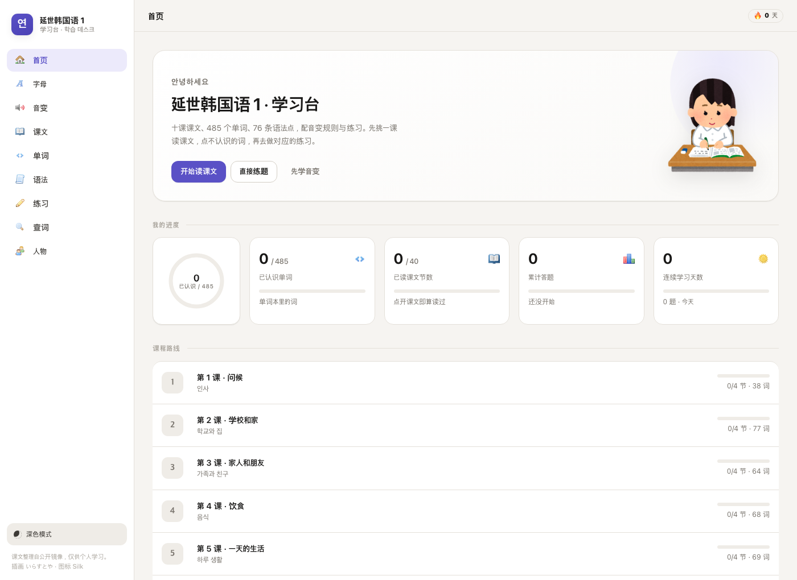
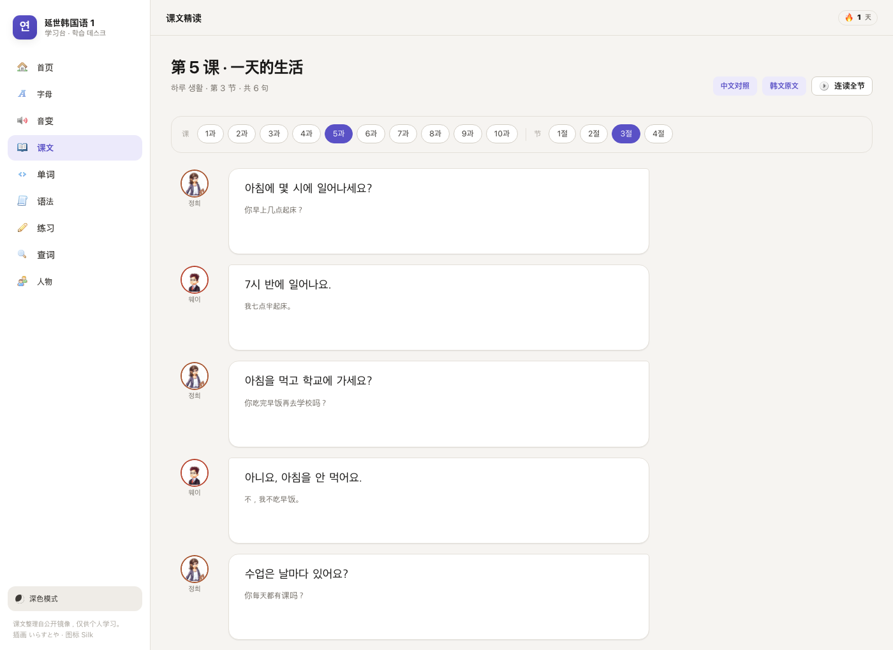
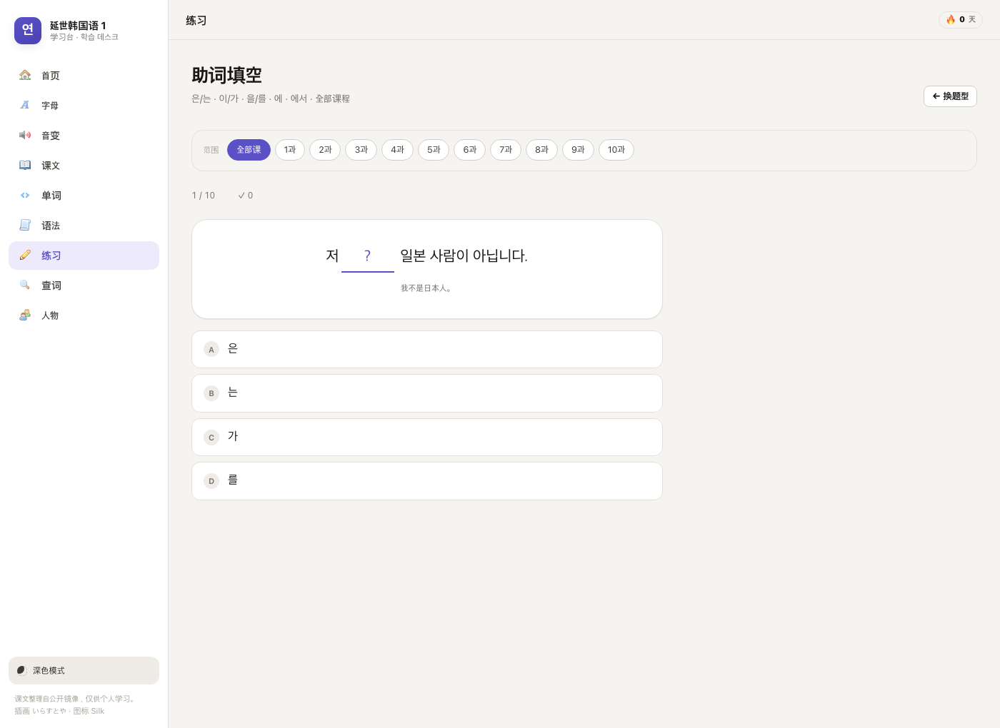

# 延世韩国语 1 · 学习台

基于《延世韩国语 1》的本地韩语学习站点。不需要构建、不需要联网、没有依赖——
双击 `index.html` 就能用。

## 部署到 GitHub Pages

纯静态站点，没有构建步骤、没有服务端、没有 `fetch`，**直接从仓库根目录发布即可**。

1. 把本目录的内容推到一个仓库的 `main` 分支根目录。
2. 仓库 **Settings → Pages → Source** 选 `Deploy from a branch`，分支 `main`、目录 `/ (root)`。
3. 等一两分钟，访问 `https://<用户名>.github.io/<仓库名>/`。

仓库里已经放好了 `.nojekyll`（否则 Jekyll 会忽略某些文件），所有资源路径都是相对的，
放在子路径（`/仓库名/`）下也能正常加载 —— 已经用 `/yonsei-korean/` 这样的子路径实测过。

推送到新仓库：

```bash
git init -b main
git add .
git commit -m "延世韩国语 1 学习台"
git remote add origin https://github.com/<用户名>/<仓库名>.git
git push -u origin main
```

推送时会要求输入 GitHub 用户名和 **Personal Access Token**（`repo` 权限），
密码方式 GitHub 早已停用。

### 改完记得递增资源版本号

GitHub Pages 给静态资源设了 `cache-control: max-age=600`，部署后十分钟内
回访的浏览器可能仍在跑旧 JavaScript —— 表现就是「刚加的功能不见了」。
`index.html` 里所有本地 css/js 都带 `?v=` 查询串，改动后执行：

```bash
python3 tools/bump-assets.py
```

它会自动把日期计数加一并把 29 处引用全部刷新，然后照常提交推送即可。
临时遇到旧版本，`Cmd + Shift + R` 强制刷新也能解决。

> ⚠️ **公开仓库前请先读 [`CREDITS.md`](CREDITS.md)。**
> 本项目的课文、词汇、语法与人物立绘来自受版权保护的教材，公开部署属于未授权分发；
> いらすとや 插画也有「不得以素材为主体再分发」的限制。请自行评估风险。

## 词条页

主页导航「词条」，或任意位置点一个词 → 弹窗里「详细 →」，都会到 。

页面内容：释义、课次、朗读、收藏 / 标记认识 / 拆整句；动词形容词**直接内嵌十种
变形**（和「变形」页共用同一份实现）；课文里真正用到这个词的例句；同课的词。

例句是用查词页同一个分析器逐句判定出来的，不是子串匹配——所以 먹다 不会误
配上 먹습니다，而真属于它的又能找出来。

## 拆字动画

「音变」页每对词、以及「变形」页每一行，点「拆」/「拆开看」会播放这样一段：

1. 先显示**原词本身**（真实字形，不是拆开的字母）
2. 隔一拍，给要变化的音节打上虚线框
3. 真正发生变化的东西动起来（见下），**全程旧词保持完全不透明**
4. 一切停稳之后才交接：旧词淡出、新词淡入（此时两者长得已经一样，
   所以读起来是字母落定，而不是另一次淡入）
5. 收尾是**真实字形**的完整单词

位移动画做在旧词自己身上：尾部音节从原位置平移让出空位，新音节以绝对
定位落进空位，只差一个字母的音节等那个字母落位后才换成新字形。若在
新词上做这些、又让它同时淡入，就会出现"词已拼好、字母还在半空"的错位。

第 3 步按三类分别处理：

| 变化 | 动画 |
|---|---|
| **移动** — 字母换位置 | 从原字形脱离，带曲线箭头飞到新位置 |
| **新增** — 新形式多出来的字母 | 从左往右错开、自上方滑入，用带回弹的缓动曲线 |
| **消失** — 新形式不再需要的字母 | 缩小滑出并淡出 |

只有当某个音节在两个词里都存在时，才对它逐字母处理；音节被整体替换或
整节新增时交给淡化，免得又变回一堆散开的字母。

这样 `앉아요 → 안자요` 不是让你记住答案，而是看见收音 ㄵ 里的 ㅈ
从 `앉` 底部脱离、落到 `자` 的声母位置；`배우다 → 배웁니다` 则是看见
多出来的 ㅂ 落进收音位置。

### 为什么只让「要移动的字母」变成独立字母

试过把整个音节拆成字母来展示，**做不到**。实测数据：

| 指标 | 数值 |
|---|---|
| 拆解与真实字形的重合度（IoU） | 19.6% |
| 穷举缩放/位置后的最好结果 | 24.5% |
| 允许任意平移后的上限 | ~40% |

原因是字体设计事实：Noto Sans KR 里独立的 `ㅇ` 在 1em 时墨迹是
0.57×0.51，而合成字 `안` 里的那个 ㅇ 是约 0.42×0.42——**更小、笔画相对更粗**。
合成用的不是独立字母的缩小版，而是另一套形态。所以拿独立字母摆位置，
永远对不上。

现在的做法绕开了这个问题：静止态和收尾态都是真实字形，**只有正在飞行的那
一两个字母是独立字形**——单个字母在运动中没人会去比对笔画。

布局参数（每个部件的格子和字号）由 `js/core/hangul-anim.js` 顶部的
`INK` 表和 `BOX` 表决定，可以用 `node tools/measure-ink.js` 重新实测生成。

双收音（ㄳㄵㄶㄺㄻㄼㄽㄾㄿㅀㅄ）会拆成两个字母共用终声格，这样
`앉아요 → 안자요` 才能表现出「ㄴ 留下、ㅈ 搬走」——而不是 ㅈ 凭空消失。

## 发音

整站朗读用浏览器自带的 `SpeechSynthesis`（ko-KR），没有音频文件、不联网。

「字母与发音」页顶部有**发音自检**，会报告系统语音总数、可用韩语语音、
本次选中了哪一个、以及引擎是否真的开始朗读。下面还列出全部韩语语音，
**逐个点一下就能试听并选定**，选择会记住。

之所以需要这个：`getVoices()` 会把系统"知道但尚未下载"的语音一并列出来，
用它们朗读时引擎照常触发 `start`、标签页也显示在出声，实际却完全静音——
不试听根本分不出哪个可用（实测 Yuna 在 macOS 上就是这种状态）。

**三个语音角色**：默认朗读、男声、女声。男声/女声留空则跟随默认；填上之后，
课文对话会按说话人性别自动切换（리에·마리아·미선·정희 用女声，
제임스·웨이·민철·영수 用男声），「连读全节」也是逐句换声。

默认选择顺序：`Natural`/`Online`（Edge 云端语音，最像真人）→ `Google` →
其它系统语音，**并主动避开趣味语音**（Eddy、Flo、Bells、Zarvox 之类，
它们排在语音列表最前面，不排除就会成为默认）。男声/女声会按语音名里
的韩文名字自动配对（서희→女、인준/현수→男）；名字对不上就不指派，
宁可跟随默认，也不把一个女声标成"男声"。

引擎若在 1.5 秒内没有开始，或在极短时间内"读完"（静音语音的典型特征），
都会直接提示原因，不会让你对着没反应的按钮猜。

## 怎么打开

**方式一（最简单）**
双击 `index.html`，用 Chrome / Safari / Edge 打开即可。

**方式二（想要本地网址）**
```bash
cd yonsei-korean
python3 -m http.server 8787
# 然后打开 http://127.0.0.1:8787/
```

朗读用的是浏览器自带的语音合成（ko-KR）。系统里装了「韩语（韩国）」语音才有声音，
macOS 可以在「系统设置 → 辅助功能 → 朗读内容 → 系统声音」里添加。

## 里面有什么

九个页面，课程内容按 *第 1–10 课 → 每课 4–5 节* 组织，可以一路循序渐进。

| 页面 | 做什么 |
| --- | --- |
| 首页 | 进度总览、连续天数、十课路线图 |
| 字母 | 21 个元音、19 个辅音、7 个收音代表音，点一下听发音 |
| 音变 | 8 条音变规则 + 6 组不规则活用，每条自带专项练习 |
| 课文 | 韩中对照，**点任意单词查词义和读音**，整句/整节朗读 |
| 单词 | 单词表、抽认卡、看韩选中、看中选韩、拼写、听音选词 |
| 语法 | 76 条语法点的接续、说明与例句，按课排序；一个句型下的编号用法（1./2./3.）各自成段、各带自己的例句；例句可以点词查询 |
| 练习 | 7 种题型，含从课文对话与语法例句**自动生成**的题目 |
| 查词 | 粘一句韩语进去，逐词拆开并还原原形 |
| 词条 | 单个词的释义、所属课次、课文中用到它的真实例句、同课的词 |
| 变形 | 动词/形容词的十种活用；每个都能**拆成字母看它怎么变** |
| 人物 | 课本里那八个人的设定、国籍、职业和台词数 |

学习进度（认识的词、收藏的词、读过的节、答题记录、连续天数）全部存在浏览器
的 localStorage 里，不上传任何地方。想清空就在浏览器里清掉本站数据。

## 内容规模

- 10 课 / 42 节课文
- 217 句对话，全部带中文对照和说话人
- 514 条课本词汇（去重后 485 个词条），另有约 150 个常用补充词
- 76 条语法点，约 380 句语法例句
- 65 组音变例词

课文能点词查询的覆盖率：**对话里 92.5% 的词**都能还原到词条；
剩下的多是数字、专有名词（잠실역）和个别口语缩略，站点会**如实标注「词库未收录」**，
不会猜一个结果给你。

## 字体

不依赖系统字体「碰运气」。中文和韩文都是**自带的开源字体**：

| 用途 | 字体 | 许可 |
| --- | --- | --- |
| 界面（黑体） | Noto Sans SC / Noto Sans KR | SIL OFL 1.1 |
| 标题与学习内容（宋体） | Noto Serif SC / Noto Serif KR | SIL OFL 1.1 |

10 个 `.woff` 文件共约 1.4 MB，用 `fontTools` 按站点实际用到的字形做了子集化
（651 个谚文音节 + 1174 个汉字）。西文（拉丁字母）优先用系统字体渲染，观感更锐利；
子集之外的字（例如你在查词框里输入的生僻字）会自动回退到系统字体，不会出现方块。

排版上做了刻意的分工：**宋体只用在「要学的内容」和标题上**（课文、例句、语法点、
人物名、卡片正面），界面一律黑体。这样一眼就能分清哪些是内容、哪些是控件。

字体许可见 [`assets/fonts/OFL.txt`](assets/fonts/OFL.txt)。

## 目录结构

```
index.html            应用外壳（hash 路由，无构建）
css/
  tokens.css          颜色、间距、字体、以及全部动效曲线与时长的唯一来源
  base.css            重置、布局骨架
  components.css      按钮、卡片、进度、气泡、闪卡……
  motion.css          入场、交错、答题反馈等关键帧
  pages.css           各页面专属样式
js/
  data/               课文语料、人物、字母表、音变规则、题库、插画清单
                      （lessons.js 由 tools/build_corpus.py 生成）
  core/               DOM 小工具、进度存储、动效、UI、语音、词典、路由
  views/              九个页面各一个文件
  app.js              导航、主题、启动
assets/
  fonts/              Noto Sans/Serif KR·SC 子集（10 个 .woff）+ OFL.txt
  irasutoya/          いらすとや 插画（73 张，已本地化）
  silk/               famfamfam Silk 图标（77 个）
  cast/               课本人物立绘与头像（16 张）
tools/                抓取与校验脚本（只在开发时用）
```

站点完全不用 `fetch` / `XMLHttpRequest`，所以 `file://` 直接打开也能跑。

## 开发脚本

```bash
python3 tools/bump-assets.py      # 改动网站文件后递增缓存版本号（见下）
python3 tools/build_corpus.py     # 从缓存页面重新生成 js/data/lessons.js
python3 tools/fetch_irasutoya.py  # 重新抓插画
python3 tools/fetch_silk.py       # 重新抓图标
python3 tools/build_fonts.py      # 重新生成字体子集（需 fontTools）
node tools/smoke.js               # jsdom 无头测试：路由、交互、语料完整性（需 jsdom）
node tools/tts-check.js           # 朗读队列时序测试（cancel/speak 竞态、连点覆盖）
node tools/browser-check.js       # 真实浏览器交互检查（需 puppeteer-core + Edge/Chrome）
```

三个测试各管一段，都是验证真实行为而不是走过场：

- **`tools/smoke.js`** 把真实的 `index.html` 和全部脚本加载进 jsdom，
  逐条渲染 21 个路由、模拟点击答题与翻卡、检查语料完整性，
  统计词典对真实对话的覆盖率，并回归两个曾经真出现过的 bug
  （弹窗被自己的打开点击关掉、`append(null)` 泄漏出字面量 `null`）。
  当前：**223 项检查全部通过，0 运行时错误**。
- **`tools/tts-check.js`** 用模拟的 `speechSynthesis` 断言朗读契约：
  `speak()` 必须在点击的同一任务里发出（否则 Safari/Chrome 会拒绝），
  cancel/resume 的顺序正确，连点不堆积，引擎不吭声时必须**告知用户**而不是静默。
  当前：**18 项检查全部通过**。
## 重建语料

    python3 tools/build_corpus.py @tools/corpus-sources.txt

**必须带 `@tools/corpus-sources.txt`。** 镜像缓存里同一课同一节存在两份标题
相同、正文不同（疑似两个教材版本）的页面，按"内容更全者胜"去重会随目录里
恰好有什么文件而漂移——曾因此把第3课第3节的单词从「집/근처/백화점…」整批换成
「산/공기/조용하다…」。这个列表把 43 个源文件固定下来，构建结果可复现
（基准：218 对话 / 514 单词 / 76 语法）。

- **`tools/conj-check.js`** 拿课本里的词形做参考，逐条比对 `js/core/conj.js`
  的输出（255 项）。韩语没有"差不多对"：`덥어요` 就是错的，教错比不做更糟。
  这套测试在开发中抓到过好几个真错误，包括 ㅂ 不规则接 `-습니다` 时 ㅂ 保留
  （课本写 `춥습니다`，不是 `추웁니다`——这一点是**查课本语料确认的，不是凭记忆**）。
- **`tools/browser-check.js`** 用 puppeteer 驱动真实的 Edge，
  点开弹窗、点外部关闭、逐个页面检查横向溢出。

另外 `tools/smoke.js` 里有一条**静态检查**：`js/` 下不允许出现原生
`Element.append()`（`append(null)` 会静默变成字符串 `"null"`）。这个 bug
先后在查词页和发音自检里出现过两次，现在由构建期直接挡掉。

## 预览





## 素材与授权

完整的来源与授权说明见 **[CREDITS.md](CREDITS.md)**。简表：

| 素材 | 自己用 | 公开部署 |
| --- | --- | --- |
| 课文 · 词汇 · 语法 · 人物立绘 | ✅ | ❌ 侵权 |
| いらすとや 插画 | ✅ | ⚠️ 建议排除 |
| Silk 图标 (CC BY 2.5) | ✅ | ✅ 保留署名 |
| Noto 字体 (OFL 1.1) | ✅ | ✅ 随附许可证 |

代码部分（`index.html`、`css/`、`js/`、`tools/`）采用 [MIT](LICENSE)；
素材不在 MIT 覆盖范围内。

## 素材与出处

- **课文、词汇、语法**：整理自《延世韩国语 1》的公开课页镜像
  （沪江韩语 / kr.tingroom.com）。**仅供个人学习使用，请勿公开传播。**
- **插画**：[いらすとや](https://www.irasutoya.com/) 的免费插画，已下载到
  `assets/irasutoya/`，不直接外链。
- **图标**：[famfamfam Silk](https://github.com/legacy-icons/famfamfam-silk)
  （Mark James，CC BY 2.5）。
- **人物立绘**：从课本「나오는 사람（出现的人物）」页裁切，共 8 个立绘 + 8 个头像。
- **发音**：浏览器内置的 SpeechSynthesis，不依赖任何在线服务。
